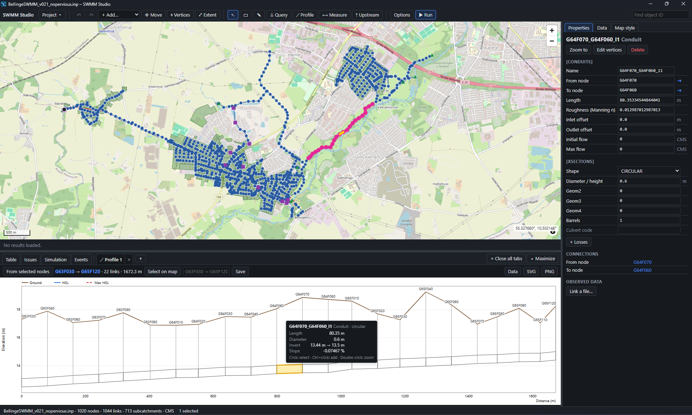

# SWMM Studio

A modern and fast desktop application to view, edit, run and analyse EPA SWMM 5 models.

SWMM Studio stays fast where other tools slow down: large networks, and continuous simulations over many years whose results files reach several gigabytes.

## Highlights

- **Your network on a real map**: see the model over OpenStreetMap in its own coordinate system.
- **Edit everything, safely**: with unlimited undo / redo and checks as you type.
- **Minimal changes**: when you save, only what you changed is rewritten. Comments, layout
  and anything SWMM Studio doesn't know are kept exactly as they were.
- **Run with your own SWMM engine**: EPA SWMM 5.1 or 5.2, OWA, or a custom build.
- **Analyse long simulations in seconds**: animated maps, multi-year time series, longitudinal
  profiles, event statistics and comparisons between runs.

## Disclaimer

This application was vibe coded: most of the source code was generated with AI coding assistants (Claude Code).

However, the process was not left entirely to the AI:

- **Specifications are human-made.** The requirements, features, architecture choices and acceptance criteria were written and decided by a human.
- **Application review is human-made.** The resulting application was tested, reviewed and validated by a human before release.

## Getting started

1. Download the Windows installer from the
   [releases page](https://github.com/SimonDelmas/swmm-studio/releases) and install it.
2. In **Engines**, register a SWMM engine (`runswmm.exe`). No engine is bundled with SWMM Studio.
3. Open a model (`.inp`), set its coordinate system, and press **F5** to run it.

A command-line tool (`swmm-cli`) is also available to run models, check them and extract results
in scripts.

Basemap © OpenStreetMap contributors.

## Licence

MIT
